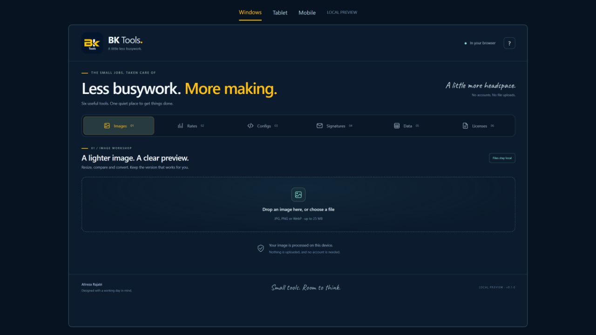

<p align="center"></p>

# BK Tools

### Less busywork. More making.

**Six practical browser tools for the small jobs that interrupt a good working day.**

Resize an image. Work out a project estimate. Open an unfamiliar CSV. Prepare an
email signature or a repository starter file. BK Tools brings these tasks into
one calm workspace, with **local file processing**, clear previews and useful
downloads.

**[Open BK Tools](https://alirezarajabi-dev.github.io/bk-tools/)** ·
**[User guide](docs/USER-GUIDE.md)** · [Verification notes](docs/QA.md)

Created by **[Alireza Rajabi](https://github.com/alirezarajabi-dev)**.

Six browser tools, designed by Alireza Rajabi, using the original Bizkonic
navy `#0c1b2e`, gold `#febf17`, teal `#82d7ce`, system/Segoe UI typography
and licensed local Caveat accent. Its dedicated icon preserves BK with
**Tools** underneath, inside the artwork.

**No signup. No file-upload service. No JavaScript libraries to install.**

Main Bizkonic, Command Desk and Field Report remain separate projects.



[Mobile preview screenshot](docs/images/mobile.png)

## Six tools, with something useful to take away

| Tool | Everyday use | Output |
| --- | --- | --- |
| **Images** | Prepare a lighter image for a page or a handover | Compared JPG, PNG or WebP, with actual byte sizes |
| **Rates** | Turn your own monthly assumptions into a project starting point | Readable estimate to copy or save |
| **Configs** | Skip the blank file at the beginning of a repository | Editable ignore files and Dockerfile starters in an exact-name ZIP |
| **Signatures** | Leave a clear, consistent last line in your email | Styled signature, HTML source or HTML file |
| **Data** | Find the records that matter in an unfamiliar file | Searchable table and filtered CSV/JSON |
| **Licenses** | Keep the full license and project notice together | LICENSE + COPYRIGHT-NOTICE.txt ZIP |

## Built for the details

- **See what you are saving.** Compare image appearance, dimensions and file size.
- **Keep your working context.** Inputs and edited configs survive internal tab switches.
- **Keep the interface responsive.** Table processing runs in a Web Worker;
  the viewer has been exercised with **50,000 rows**.
- **Get usable files.** ZIPs preserve dotfiles and extensionless filenames;
  nested JSON survives export and CSV can protect against formula-like text.
- **Use the screen in front of you.** Responsive layouts, keyboard-accessible
  tool tabs, visible focus states and a dedicated **BK + Tools** installation icon.

## Run

Node.js 20+; no dependencies to install and no build step.

```sh
git clone https://github.com/alirezarajabi-dev/bk-tools.git
cd bk-tools
npm start
```

App: http://127.0.0.1:8866/

- Windows preview: http://127.0.0.1:8866/review/desktop
- Tablet preview: http://127.0.0.1:8866/review/tablet
- Mobile preview: http://127.0.0.1:8866/review/mobile

These simulate viewport sizes; they are not physical-device certification.
File downloads in the framed preview use a visible **Save file** bar. The full
app downloads directly; the bar keeps the scaled preview and its data in place.
Use HTTP rather than opening index.html directly: local text fetches and module
workers need the local server. The server is loopback-only, read-only and exposes
an explicit runtime-file allowlist.

## The six tools

1. **Images** — local JPG/PNG/WebP input, original/result preview, output format,
   quality, aspect-preserving maximum width, byte sizes, savings/larger percentage
   and download. No upscaling. JPEG fills transparency with white; PNG's quality
   slider is disabled. Canvas encoding does not carry image metadata. A still
   image is produced; this is not an animation editor. Limits: 25 MB / 40 MP.
2. **Rates** — expenses, take-home goal, billable hours, chosen income reserve,
   project hours/buffer and separately added sales tax. Currency is a label, not
   FX conversion. Copy/download a planning estimate; this does not issue invoices
   or apply country-specific tax rules.
3. **Configs** — editable .gitignore for Node/Python/React/Go/containers,
   stack-specific Dockerfile starters and a .dockerignore. Exact filenames are
   preserved inside the downloaded ZIP. Docker images/commands/ports are starters
   for review; no Docker builds are executed. npm examples assume package-lock.
4. **Signatures** — live escaped fields, validated http/https links, table layout
   and inline styles; rich clipboard copy, HTML source copy and HTML download.
   Native Gmail/Outlook rendering/pasting must be checked in those email clients.
5. **Data** — UTF-8 CSV/JSON, quoted commas/newlines/escaped quotes, BOM, separator
   auto/manual choice, headers, duplicate heading normalization, search, stable
   numeric sorting, 25/50/100-row pages and filtered CSV/JSON export. A module
   worker handles parsing/search/sort/export. Limits: 10 MB, 50,000 rows, 100
   columns, 1 million cells. Unsafe formula-like spreadsheet text is prefixed
   by default in CSV exports; nested JSON survives JSON export unchanged.
6. **Licenses** — full bundled MIT, Apache 2.0, GPL v3 and BSD 3-Clause texts.
   MIT/BSD placeholders are filled; GPL/Apache canonical text is unchanged.
   Project notice is separate, with GPL only/or-later explicit. Download a ZIP
   containing LICENSE and COPYRIGHT-NOTICE.txt, preserving exact names.

## Privacy and downloads

No accounts, analytics, backend, uploaded files, localStorage or cloud state.
File contents and form values stay in browser memory while open. Only bundled
same-origin application assets/texts are fetched. Source links open only if the
user chooses them. Local preview CSP restricts processing connections to self.

Desktop downloads use the ordinary download attribute, with visible filename
feedback. On compatible iPhones/iPads, Save uses the native file share sheet;
the user chooses Save to Files or another destination. If that API is unavailable,
the fallback keeps the app open separately. Browser/device download behavior and
physical iPhone saving are not certified by a viewport simulation.

Image/file results survive switching tabs during this page session. Leaving the
page clears image/worker resources. Editable configuration output survives normal
tab switches; choosing a new template intentionally replaces it.

## Sources, licensing and verification

Full source URLs and SHA-256 hashes are in assets/sources.json. License texts:
SPDX license-list-data, Apache Software Foundation and GNU. Ignore templates:
github/gitignore, with upstream CC0 text preserved in assets/templates/.
The local Caveat font license is beside its font. BK source artwork belongs
to the owner's existing visual system; the main logo was not altered.

```sh
npm test
```

**37 automated checks/suites** exercise financial arithmetic/invalid inputs, escaped signature/link fields,
Docker command injection boundaries, canonical full-license preservation, image
dimensions, CSV grammar/ragged rows, JSON prototype-like keys, numeric sort,
pagination, export safety and ZIP filename/path handling. See docs/QA.md for
actual browser tests and remaining physical-device/email-client limits.

---

**Designed and developed by Alireza Rajabi.**
